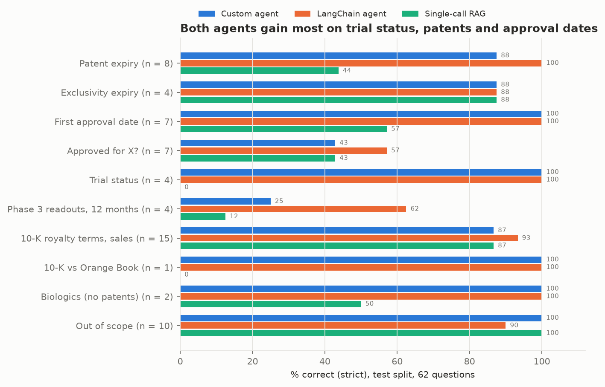
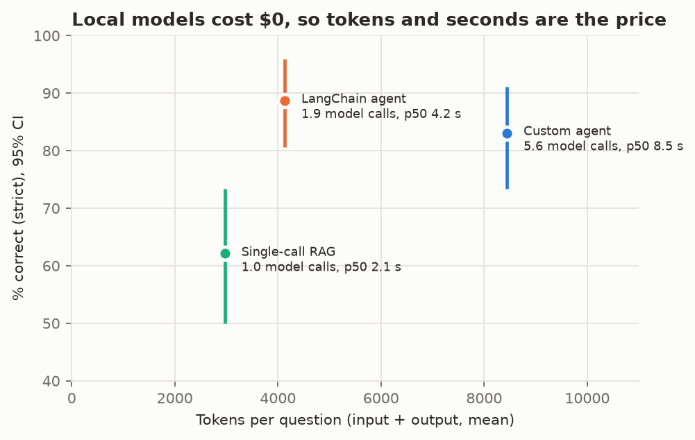
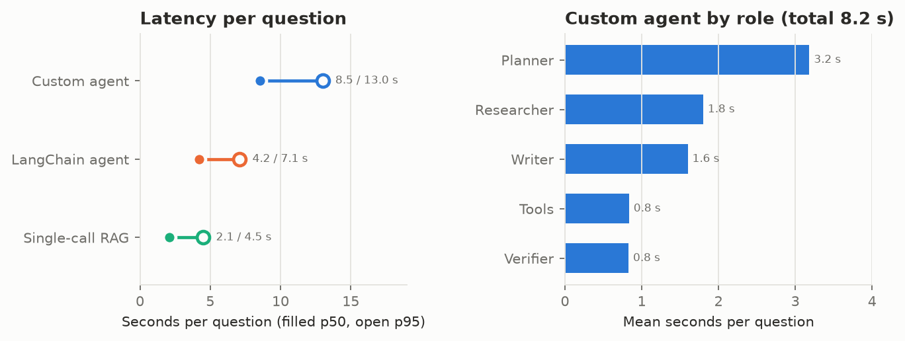

---
date:
  created: 2026-11-05
slug: diligence-agent
authors:
  - chris
categories:
  - Generative AI
  - Evaluation
  - Healthcare
description: Two tool-calling agents and a single-call RAG baseline answer drug diligence questions from the Orange Book, ClinicalTrials.gov, openFDA and SEC filings, scored against a test split frozen at a git tag.
---

# A tool-calling agent for drug diligence, tested against a frozen split

An investment team asks the same questions about every marketed drug. When does its last Orange Book patent expire?
Which Phase 3 trials read out in the next 12 months? What does the 10-K say about the royalty? Is it approved for a
given indication? Each answer sits in a public system of record. I built two agents that answer these questions from
those records with a citation for every claim, and scored them against a single-call RAG baseline on a test split I
froze at a git tag before any test answer existed.

<!-- more -->

!!! abstract "TL;DR"
    - **Drugs:** the 32 products in Royalty Pharma's royalty portfolio, from its 10-K for 2025.
    - **Tools:** FDA Orange Book, Drugs@FDA and labels (openFDA), ClinicalTrials.gov API v2, SEC EDGAR, PubMed, and hybrid search over the 10-K and labels. Read-only, cached, rate-limited, with retries and pydantic-validated arguments.
    - **Systems:** a custom agent (planner, researcher, verifier, writer), LangChain's `create_agent` with the same tools, and single-call RAG. All three run `gemma4:e4b` locally through Ollama on an 8 GB GPU.
    - **Result:** on 62 held-out questions, the custom agent scores 83.1% strict correctness and LangChain 88.7%, against 62.1% for single-call RAG. Paired differences: +21.0 points [+9.7, +33.1] and +26.6 [+14.5, +38.7]. The agents don't differ measurably: −5.6 [−13.7, +1.6].
    - **Cost:** $0 in dollars. The custom agent uses 8,446 tokens and 8.5 s (p50) per question, LangChain 4,136 and 4.2 s.
    - **Judge:** `gemma4:26b` agreed with my labels at κ 0.48, under the pre-registered 0.6, so my labels replaced it on the questions it graded.
    - **Code:** [github.com/RonCom/diligence-agent](https://github.com/RonCom/diligence-agent).

## The questions

I wrote the 93 questions from the systems of record themselves, so every gold answer traces to a record: a patent
row in the Orange Book data files, a study in ClinicalTrials.gov, an application in Drugs@FDA, a table row in the
10-K. Ten categories:

- patent and exclusivity expiry
- first approval date
- "is it approved for X?"
- trial status
- Phase 3 readouts in a 12-month window
- 10-K royalty terms and sales
- the 10-K's patent estimate set against the Orange Book
- Orange Book patents for a biologic, where the right answer is that none are listed
- 15 out-of-scope questions (list prices, analyst targets, EU patents), where the right answer is a decline

28 are worded the way an analyst would type them: "Any Imdelltra Phase 3 readouts coming in the next 12 months?"

Code grades almost everything: the gold date, the NCT ids (F1), the dollar amount within 1%. A judge model grades
the 8 questions where the 10-K's wording matters ("tiered royalty of 15% on the first $1 billion of U.S. sales").
Two rules from my [policy-rag project](policy-rag.md) apply on top of every check. Declines are detected in code,
and a decline on a question the records answer scores 0. In policy-rag, the judge passed every such decline.

## Three systems, one model

**The custom agent** has four roles. A planner splits the question into steps and picks tools. A researcher calls
them with native tool calling, under a budget: 12 model calls, 60,000 tokens, 600 seconds. It refuses a repeated
call with the same arguments and stops after 3 turns without new evidence. A writer answers from the collected
records only. A verifier checks each claim in code (every cited record was collected, and every date and
percentage in the claim appears in it), then with the model. Claims that fail get one more research round, and
whatever still fails is cut.

**The LangChain agent** is `create_agent` with the same seven tools, a model-call limit, and middleware that traces
each call and refuses repeats. It has no planner and no verifier.

**Single-call RAG** retrieves 8 chunks from an index that holds the 10-K, the labels, and the Orange Book,
Drugs@FDA and ClinicalTrials.gov records for all 32 products, flattened to text. Then it makes one model call. Every
gold record is in its index, so the comparison tests tool calling against retrieval, with the same information
available to both.

Every question is one MLflow trace, with a span per role, model call and tool call, carrying latency, tokens,
dollars, model id, prompt hash and cache hit.

## Freezing the test

The 93 questions split 31 dev, 62 test. Every prompt change, budget change and grader fix happened on dev. Before
the test run, I wrote four tests into `config.yaml`:

- **H1 and H2:** each agent beats single-call RAG, with a paired bootstrap 95% CI above zero and no more false
  declines.
- **H3:** the two agents differ.
- **H4:** each agent declines at least 9 of the 10 out-of-scope questions.

I froze the block and tagged the commit `eval-test-v1`. The scorer refuses the test split unless HEAD is a clean
checkout of that tag, and it refuses to score a repeat twice. The test ran twice. Single-call RAG and LangChain gave
the same 62 answers both times. The custom agent changed 2 answers and 1 grade.

| Test | Result |
|---|---|
| H1: custom agent vs single-call RAG | **pass**, +21.0 points [+9.7, +33.1]; false declines 4 vs. 10 |
| H2: LangChain vs single-call RAG | **pass**, +26.6 points [+14.5, +38.7]; false declines 1 vs. 10 |
| H3: custom agent vs LangChain | **no difference shown**, −5.6 points [−13.7, +1.6] |
| H4: out-of-scope declines | **pass** after one deviation: custom agent 10 of 10, LangChain 9 of 10 |

H4 failed as first scored, at 8 of 10 for LangChain. One of its misses was the Ozempic question: "The search for the
royalty rate on Ozempic in Royalty Pharma's 10-K filings did not return any records." My decline detector had
treated an empty search as a finding. I decided after the test run that it's a decline, changed the detector, and
recorded the change with its full effect in the config. That effect: LangChain from 87.1% to 88.7%, and three
biologic answers reclassified with no change in score. The first scoring is saved beside the second.

## Where the points come from

Single-call RAG loses its points on questions whose answer is a field:

- trial status: 0 of 4, all declined;
- patent expiry: 44%;
- first approval date: 57%.

The gold record is in its index each time. Finding the last-expiring patent means comparing every patent row for a
drug, and 8 chunks don't hold them all. On dev, rank fusion also pushed exact NCT ids below the top 8 when BM25 had
them first. The agents call `orange_book` and `ctgov_search`, which return the fields directly. On the 10-K
questions, where all three read the same chunks, the systems are within one question of each other.

Two categories hold the agents back:

- **Readout windows:** the custom agent scored 25%. It declined two questions and hit its 12-call budget on the
  other two with partial lists. LangChain scored 62%.
- **"No" indications:** questions whose answer is no ("Is Imdelltra approved for limited-stage small cell lung
  cancer?") scored 0 for the custom agent on all 4: one decline, and three answers that describe the approved
  indication without opening with "no". Across the three systems, 5 of the 12 answers to these questions do say
  the asked-about indication isn't approved or listed, but in a second sentence or as "the label does not list X". The yes/no
  check reads the first sentence, and the decline detector reads "does not list" as a decline. That's a grader
  limit I found after the test was spent, so it stays in the numbers. The fix goes to a new test split, along with
  a writer prompt that opens with "Yes" or "No".

## What the planner and verifier buy

LangChain matches or beats the custom agent at half the tokens and a third of the model calls (1.9 vs. 5.6). The
planner is the largest share of the custom agent's time, 3.2 s of 8.2 s on average.

What the verifier does buy is citation hygiene. I ran its code check on every system's saved answers:

| System | Claims passing |
|---|---|
| Custom agent | 61 of 61 |
| LangChain | 71 of 77 |
| Single-call RAG | 65 of 68 |

The custom agent's verifier had already cut 6 of the 66 claims it checked, before the answers were written out.

The check has a gap, though. The custom agent's Imdelltra royalty answer gave Trodelvy's tiers, which sit in the
same 10-K table, cited that table, and passed: every percentage in the claim was in the record. A code check
confirms a number exists in the source. It can't confirm the number belongs to the drug in the question.

With a hosted model, the token column turns into dollars, and that's the comparison that decides whether the
verifier earns its calls. The next dev experiment is dropping the planner.

## The judge didn't make the bar

I labeled 40 dev answers: all 12 the judge grades, plus a sample across categories. I set the bar before labeling:
the judge counts only at κ ≥ 0.6. It reached 0.48 on correctness. Four of its five disagreements were declines on
answerable questions that it passed, the same leniency policy-rag found. On faithfulness, I labeled all 40 faithful
and the judge failed two wrong answers whose records matched what they said. It was grading correctness under the
faithfulness label.

The pre-registered fallback took over. My labels grade the judge's 8 questions, and faithfulness comes from the
verifier's code check. On the test split, that meant labeling 12 distinct answers myself before any hypothesis was
computed.
