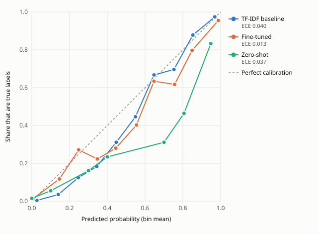

# Which FINRA rules did this conduct break? Classifiers and retrieval tested against FINRA's own charges

FINRA, the regulator for U.S. broker-dealers, publishes a summary of every disciplinary action it takes each month. An enforcement or compliance team reading a complaint, a tip or an exam finding asks "**which rules does this conduct touch?**" I built classifiers that answer it from the facts of a case with the rule numbers removed, and tested them against the rules FINRA actually charged. The expectations were written down before any data was pulled, and the test years were scored once. All three classifier expectations failed, for one reason: FINRA's summaries name the conduct in the rules' own words. The same fact helped the second half, a retrieval system over the FINRA Rulebook, which met all three of its expectations.

<!-- more -->

!!! abstract "TL;DR"
    - **Data:** 6,198 cases from FINRA's monthly "Disciplinary and Other FINRA Actions" reports, January 2016 to September 2026 (129 months), and each case's full document (AWC, complaint or decision) from FINRA's Disciplinary Actions Online.
    - **Labels:** rules read from the violation sentences of each case document by a rule-based extractor, grouped into 15 rule series; four 100-case hand-checks (precision 0.88-0.97, recall 0.94-1.00).
    - **Models:** TF-IDF with logistic regression, ModernBERT-base fine-tuned (three seeds averaged), and a local LLM (gemma4 through Ollama) zero-shot.
    - **Result on 2024-2026 (1,143 cases):** macro-F1 **0.693 baseline, 0.694 fine-tuned, 0.664 zero-shot**. The fine-tuned model didn't beat the baseline by the 0.05 called for (H1 failed), and the zero-shot model came within 0.03 of it, not 0.10 behind (H2 failed).
    - **Full document vs. summary:** a second model reading each case's facts section scored **0.614 against the summary model's 0.681** on 300 test cases (H6 failed in the other direction).
    - **Retrieval over the Rulebook:** keyword search (BM25) put a charged rule in the top 5 for **71.3%** of 950 test cases (H3, pass line 70%); the local model declined **20 of 20** out-of-scope questions (H4); an LLM judge agreed with checked labels at **κ 0.741** (H5, pass line 0.60).
    - **Stack:** Python, DuckDB, scikit-learn, PyTorch and Hugging Face Transformers, Ollama, PyMuPDF and Tesseract, pytest, uv. Code: [github.com/RonCom/finra-enforcement-nlp](https://github.com/RonCom/finra-enforcement-nlp).

!!! warning "Settled charges aren't every rule the conduct broke"
    The labels are the rules FINRA charged and the respondent settled or was found to have violated. Conduct can touch rules FINRA chose not to charge. The summaries are also written by FINRA staff who know the charges, so scores here are an upper bound for classifying a raw complaint or tip.

## The question and the pass lines

The specification (`docs/spec.md` in the repo) fixes the sources, the labels, the models, the split by action date (train 2016-2022, validation 2023, test 2024-2026) and six expectations:

| ID | Test | Pass line |
| --- | --- | --- |
| H1 | Fine-tuned transformer vs. TF-IDF baseline, test macro-F1 | Gain ≥ 0.05 |
| H2 | Zero-shot local model vs. fine-tuned transformer | Zero-shot lower by ≥ 0.10 |
| H3 | Retrieval over the FINRA Rulebook: a charged rule in the top 5 results | ≥ 70% |
| H4 | Out-of-scope questions declined | ≥ 18 of 20 |
| H5 | LLM judge vs. hand labels, Cohen's κ | ≥ 0.60 |
| H6 | Full case document vs. monthly summary as input | Gain ≥ 0.03 |

Every rule changed after data was seen is in a dated change log at the bottom of the spec, with the reason. Test scoring runs only from code at a `freeze-*` git tag on a clean tree, and refuses to run twice. H3 to H5 cover the retrieval system over the FINRA Rulebook (below).

## Cases: 129 monthly reports

FINRA's monthly reports go back to 2016 as PDFs and recent years as HTML. The scraper found all 129 published months and parsed 6,657 write-ups into 6,198 unique cases (a case can appear in more than one month). Along the way it had to handle quarterly reviews filed under the same path, a misspelled file name on five 2017 reports, and month names shortened or reordered in file names.

Each summary's numbered rule references ("FINRA Rule 3110", "Exchange Act Rule 17a-4") are replaced with `[RULE]`, and a check fails the build if any numbered reference survives. Rule titles stay in: "outside business activities" describes the conduct as much as it names the rule.

## Labels: reading the charges from the case documents

Recent summaries leave out rule numbers for most cases, so the labels come from each case's full document. The extractor reads the rules from the sentences that state a violation ("...and therefore violated FINRA Rules 3110 and 2010") and skips the procedural-rights waiver, earlier cases cited as disciplinary history, and rules quoted only as background. Where a document gives no rule, the summary's own citations are the label (20 cases), then an OCR pass over scanned or garbled PDFs with Tesseract (114 cases). 6,111 of 6,198 cases have labels.

The spec set a gate of 0.98 precision and recall on 100 hand-checked cases. Four rounds of checks scored precision 0.881, 0.907, 0.973 and 0.936 and recall 0.966, 0.944, 1.000 and 0.981. Each round's errors became extractor rules: OCR misreadings of "FINRA" and digits, footnote numbers fused to rule numbers, prior-case sentences, procedural rules. The gate was missed, and I accepted it in the change log: at the level the classifiers use, rule series, 3-5% of checked cases carry a wrong label.

Labels are rule series as the Rulebook numbers them (FINRA 1000 registration, 2000 duties and conflicts, 3000 supervision, 4000 books and records, 8000 investigations, and so on), plus MSRB rules, SEC rules, Exchange Act and Securities Act sections, and Regulations NMS and SHO. Two rules were needed before the classes made sense:

- **Rule 2010 is dropped.** FINRA charges "standards of commercial honor" next to nearly every other violation.
- **NASD rules map to their FINRA successors.** NASD 3010 became FINRA 3110 in the 2008-2012 consolidation; without the map, one obligation split into two classes by conduct date, and the NASD classes scored F1 0.24-0.53 on validation.

## Three classifiers

- **Baseline:** TF-IDF over words and word pairs, one-vs-rest logistic regression with balanced class weights.
- **Fine-tuned:** ModernBERT-base with a multi-label head, positive-class weights of √(negatives/positives) capped at 10, six epochs with the best epoch chosen on validation. One seed's macro-F1 swung by 0.028 from another's, so the test uses the average of three seeds' probabilities.
- **Zero-shot:** gemma4 (26B, through Ollama on an 8 GB GPU) gets a one-line description of each series and returns a probability per series in a fixed JSON schema. Two prompt versions were compared on validation; the second won (0.707 vs 0.672 over series with 10+ cases). Ollama's flash attention, an 8-bit key-value cache and two parallel requests made it 35% faster, after a recheck showed the answers hadn't moved.

On validation (2023), macro-F1 over series with 10+ cases was 0.782 for the baseline, 0.813 fine-tuned and 0.707 zero-shot.

## Test results, 2024-2026

| Model | Macro-F1, all 15 series | Macro-F1, 14 series with 10+ test cases |
| --- | --- | --- |
| TF-IDF + logistic regression | 0.693 | 0.714 |
| ModernBERT-base, fine-tuned, average of 3 seeds | 0.694 | 0.715 |
| gemma4:26b zero-shot | 0.664 | 0.691 |

| ID | Result | 95% interval (paired bootstrap) | Verdict |
| --- | --- | --- | --- |
| H1 | +0.000 (fine-tuned minus baseline) | -0.023 to +0.025 | Failed |
| H2 | +0.030 (fine-tuned minus zero-shot) | -0.006 to +0.073 | Failed: labeled data adds little here |

The two trained models tie overall and split by series. The fine-tuned model leads on SEC rules (0.657 vs 0.581); the baseline leads on Exchange Act sections (0.687 vs 0.612). Both score 0.95 on supervision and 8210 cooperation cases, the two biggest series.

The zero-shot model is close wherever a series has its own vocabulary: 8210 cooperation 0.959, MSRB 0.905, trade reporting 0.905. It loses where the label depends on FINRA's charging habits. It predicts registration (FINRA 1000) for 143 test cases against 56 true ones, because any mention of a Form U4 reads as a registration violation. And it splits statutes from their rules differently from FINRA's drafting.

**Why H1 and H2 failed.** Monthly summaries are short and name the conduct in the rules' own words: "failed to supervise", "outside business activity", "refused to appear for on-the-record testimony". With rule numbers masked, those phrases carry most of the signal, and word pairs capture them as well as a fine-tuned encoder does. A model with no labeled data, told only what each series covers, came within 0.03.

### Calibration

Every case-and-series probability, binned. The fine-tuned model has the lowest calibration error (0.013) because it commits: 86% of its probabilities are under 0.1 and 7% over 0.9, where it's close to right. In its 0.5-0.6 and 0.7-0.8 bins it overstates by 0.14-0.15. The baseline's class weights push its low-middle probabilities up (of points it scores 0.1-0.2, 3.5% are true). The zero-shot model answers in steps of 0.1 and is overconfident: of the points it scores 0.8-0.9, 46% are true labels. Its F1 is close at the 0.5 threshold, but its probabilities can't rank cases for review.

## Does the full case document beat the summary?

The summary is FINRA's one paragraph about a case; the AWC behind it runs pages. H6 asked whether a model reading the document does better. The catch is that the labels come from the document's violation sentences, so the whole document hands the model its answer: masking the numbers doesn't hide "violated [RULE] by failing to supervise".

So the document input is its facts section, cleaned until it no longer states the charge. Five extraction rounds, each checked on printed samples before any training:

1. Start at the facts heading; drop "(Violation of ...)" sub-headings.
2. Drop every sentence that states a violation.
3. Drop sentences that quote or explain a rule ("[RULE] prohibits registered persons from being an employee of another person..."). Quoting the rule names the charge as plainly as its number does.
4. Stop at the sanctions, and drop sanction sentences wherever they fall. A bar or a fine of a set size points to the charge, and decisions and appeals discuss sanctions throughout.
5. Match all of the above through OCR misreadings ("conscnt to thc imposition", "viola?d").

The first version kept 2,820 of 6,125 cases, because it stopped at the first violation sentence and lost every later charge's narrative. The last kept 5,493, with 2 sentences still carrying a rule number and about 3 cases with sanction boilerplate the OCR garbled.

A second ModernBERT was trained on 4,007 facts sections the same way as the summary model and compared on 300 random test cases:

| Input | Macro-F1, all series | Series with 10+ cases in the sample |
| --- | --- | --- |
| Monthly summary | **0.681** | **0.835** |
| Facts section | 0.614 | 0.773 |

The facts model is 0.067 behind (95% interval -0.114 to -0.016; no bootstrap resample above zero). It loses most on statutes (Exchange Act sections 0.571 vs 0.731), where the sentences that separate Section 17(a) from Rule 17a-4 were the ones removed as explaining a rule. It over-predicts registration (33 predictions against 17 true), because facts sections mention Form U4 as background in many cases. Where the conduct names the series, the two tie: 8210 cooperation, supervision, MSRB, trade reporting.

This isn't a neutral comparison of documents. The facts input is what's left after removing everything that gives the label away, and those removals take some conduct with them. What it shows is that FINRA's summary carries at least as much usable signal as the stripped narrative it was written from.

## Retrieval over the Rulebook

The second half asks whether a retrieval system over the FINRA Rulebook finds the rules FINRA charged, and whether a local model answering from it declines questions the Rulebook doesn't cover. It starts from the design of my [Medicare policy RAG](policy-rag.md): rule pages in chunks of about 250 words, BM25 keyword search and embedding search (nomic-embed-text through Ollama) fused by reciprocal rank, and a local model (gemma4) that cites rules from the top 5 or declines.

FINRA's terms of use restrict bulk copying and machine-learning use, with an exception for fair use. This is non-commercial research, the repo carries FINRA's copyright notice, and no FINRA text is redistributed beyond short excerpts. The download ran at one page every 15 seconds after finra.org answered 429 at a faster pace; 739 pages became an index of 657 rules (2,399 chunks): each page's tab labels and amendment history stripped, section headings with no text of their own and deleted rules left out.

### What validation changed

The first validation run put a charged rule in the hybrid top 5 for 27% of cases and in the BM25 top 5 for 44%. Three changes, each logged in the spec before the test run, took them to 62% and 64%:

1. **Drop the sanction sentence from the query.** Every summary opens with "censured and fined $50,000", which matched FINRA's rules about sanctions (8310, 8320, BrokerCheck disclosure) better than the rule broken. Keeping only the conduct, "the entry of findings that X", took hybrid from 0.27 to 0.51.
2. **One chunk per rule.** Long rules filled several of the 5 slots; each rule now competes with its best chunk.
3. **Search the conduct rules only.** All 491 charged rules in validation were conduct rules (0100-8000), while the Code of Procedure and the arbitration codes took 14% of the slots. Out-of-scope questions still search everything.

Then H3's retriever was chosen: **BM25**, which beat hybrid and dense on every run. A larger embedding model (bge-m3) raised dense search a little and lowered hybrid. Summaries and rules share their key words, and fusing in a weaker ranking costs more than it adds.

### Test results

| ID | Result | Verdict |
| --- | --- | --- |
| H3 | 71.3% of 950 test cases have a charged rule in the BM25 top 5 (hybrid 67.2%, dense 46.3%) | Met |
| H4 | 20 of 20 out-of-scope questions declined | Met |
| H5 | Judge vs. checked labels: κ 0.741, agreement 87% | Met |

**H3** cleared its line by 1.3 points, and validation was 64%, so the margin is thin. It works best where a series has its own vocabulary (trade reporting 0.91, offerings 0.90, supervision 0.80) and worst on registration (0.52) and books and records (0.54), whose rule titles ("General Requirements") say little.

**H4** comes with a caveat. The same model declined 43 of the 100 in-scope test cases it was asked about. It declines whenever no excerpt covers every part of the conduct, and three prompt versions on validation didn't change that. So the decline works when it should; the system also gives up on cases it could answer. Of the 57 answers it gave, 51 cited a charged rule and nothing unrelated.

**H5** measures whether the local model can grade its own answers. The judge agreed with the checked labels on 87 of 100 answers, and every disagreement went the same way: 13 answers the labels called correct, the judge called incorrect, so the judge is stricter (38% correct against 51%). The labels were drafted by an AI assistant model, blind to the judge, with a written reason per row; I reviewed every row against the case summary and changed none. H5 is agreement with labels a person confirmed, not labels a person wrote from scratch.

## Engineering

- **One DuckDB file per job,** so the facts extraction, the Rulebook download and the index build run side by side.
- **A polite HTTP client** with an on-disk cache, a declared User-Agent, and backoff on each 429; the Rulebook crawl pauses 5 minutes when refused and resumes from its cache.
- **Resumable LLM runs:** every zero-shot answer, retrieval answer and judge label is stored with its prompt version and model, so an interrupted run picks up where it stopped and a prompt change is a new version, not an overwrite.
- **Tests on every push** (GitHub Actions), including the masking check and the facts-filter cases found in each extraction round.

## Limits

- **Label noise** of 3-5% of cases at the series level is about the size of the differences between the models.
- **Summaries only** for H1 and H2; H6 tested facts sections and found them worse.
- **Rare series:** "other" (12 test cases, merged rare series) scores 0 for both trained models, which costs them about 0.05 of all-series macro-F1.
- **Validation to test drift:** both trained models lost 0.07-0.08 from 2023 to 2024-2026; the test years bring series that were rare in training (FINRA 5000 has 48 test cases against 8 in validation). The zero-shot model, with no training labels, held steady (0.667 to 0.664).
- **One zero-shot model and prompt,** series descriptions written by hand.
- **One local model answers and judges** its own answers; H5 checks how far that can be trusted, against labels drafted by a second model and confirmed by a person.
- **Today's Rulebook:** rules amended since a case was charged may retrieve correctly but read differently than they did then.

The code, spec with change log, and full results are at [github.com/RonCom/finra-enforcement-nlp](https://github.com/RonCom/finra-enforcement-nlp).
